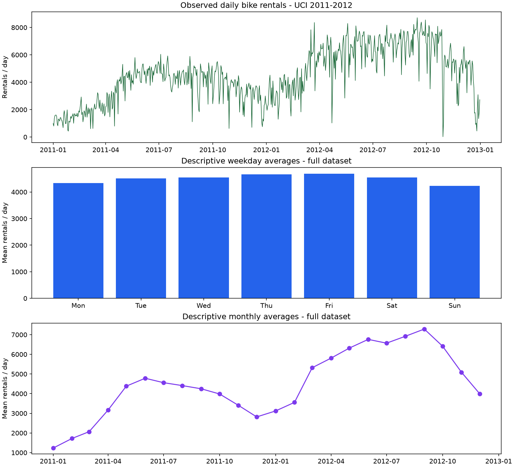
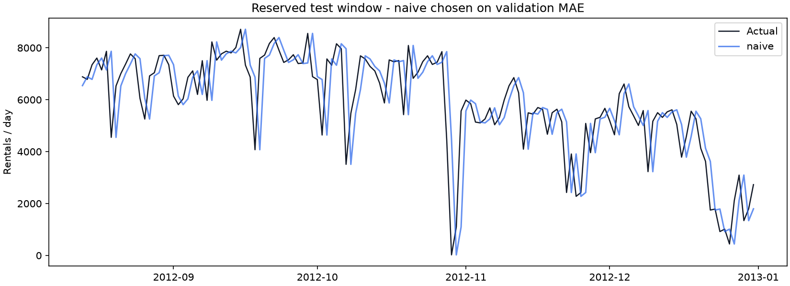

# Week 1/2 forecasting results

Real UCI daily bike-rental benchmark. Team confirmation of proposed project/domain adaptation pending. Run date: 18 October 2026.

## Data and quality

731 daily observations, 2011-01-01 through 2012-12-31. No missing dates, duplicate dates, nulls or negative/noninteger targets. Total demand equals casual plus registered for every row. Raw files are preserved with SHA-256 hashes. No source records were imputed or deleted. The first 28 rows are excluded from modeling only to warm up past-only features.

## Baselines

| Window | Baseline | Days | MAE | RMSE | WAPE % | Bias |
| --- | --- | --- | --- | --- | --- | --- |
| validation | naive | 141 | 847.21 | 1218.73 | 13.31 | -22.50 |
| validation | seasonal_naive_7 | 141 | 1063.32 | 1430.87 | 16.70 | -33.77 |
| test | naive | 141 | 894.30 | 1301.79 | 15.26 | 27.06 |
| test | seasonal_naive_7 | 141 | 1223.43 | 1790.03 | 20.88 | 249.69 |

Chosen on validation MAE: **naive**. Split boundaries and full-precision metrics are in results.json. All methods use the same validation/test dates. Bias is forecast minus actual; positive means overprediction. WAPE aggregates absolute errors over total observed demand, rather than averaging daily percentages.

## Interpretation and limits

Daily observed rentals are a demand proxy, not unconstrained demand or inventory sales. There is only one aggregate series, no SKU/store or stockout labels, and no supplier/stock information. The descriptive EDA uses the full dataset but does not tune models; model selection uses validation MAE only. Same-day weather and target components are excluded from features. Later observed test-day targets enter subsequent one-day forecasts, as permitted by the stated rolling-origin contract; do not present these as a multi-day forecast made before the whole test window.

No causal claims, inventory savings, advanced model improvement or production readiness are established. Dataset age, two-year coverage, seasonal changes and unusual events limit generalization. Dashboard/API, advanced models and real inventory backtesting remain later work.

## Figures

