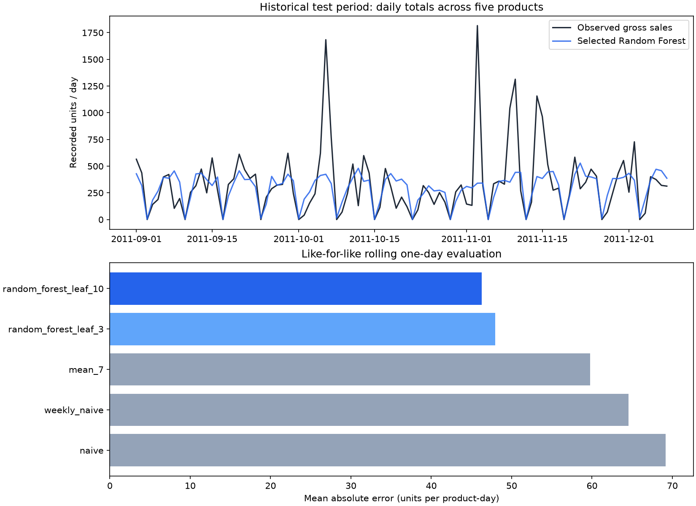

# Pranav lead contribution - retail forecasting

Executed 26 October 2026. This is a tested local prototype, not the full team submission.

## What is implemented

Real UCI Online Retail inputs; documented gross-sales cleaning; five products selected using training invoice coverage only; past-only features; fixed calendar splits; three simple baselines and two Random Forest configurations; validation-only model selection; test predictions; per-product errors; trusted local model artifacts; one-day inference CLI.

## Data audit

- raw_rows: 541909
- exact_duplicate_rows: 5268
- cancelled_rows: 9288
- nonpositive_quantity_rows: 10624
- nonpositive_price_rows: 2517
- eligible_gross_sales_rows: 475216
- calendar_rows_without_sale_records: 377

Exclusion counts overlap and must not be summed. Customer IDs are not used in features or derived data. Exact-duplicate removal and zero-recorded-sales days are explicit assumptions for Gourav to review. Missing stockout flags mean measured sales may understate latent demand. Source metadata says no missing values, but actual workbook null counts are recorded in quality.json and take precedence.

## Actual model results

| Split | Model | Product-days | MAE | RMSE | WAPE % | Bias (forecast - actual) |
| --- | --- | --- | --- | --- | --- | --- |
| validation | naive | 310 | 76.48 | 140.65 | 111.30 | 0.62 |
| validation | weekly_naive | 310 | 69.58 | 132.05 | 101.25 | 1.22 |
| validation | mean_7 | 310 | 65.58 | 110.28 | 95.44 | 1.40 |
| validation | random_forest_leaf_3 | 310 | 54.75 | 101.60 | 79.67 | -0.66 |
| validation | random_forest_leaf_10 | 310 | 53.66 | 99.92 | 78.09 | -1.88 |
| test | naive | 495 | 69.16 | 151.23 | 102.56 | -0.23 |
| test | weekly_naive | 495 | 64.52 | 157.54 | 95.68 | -2.42 |
| test | mean_7 | 495 | 59.78 | 127.83 | 88.65 | -1.43 |
| test | random_forest_leaf_3 | 495 | 47.96 | 118.55 | 71.13 | -6.56 |
| test | random_forest_leaf_10 | 495 | 46.29 | 116.75 | 68.64 | -8.30 |

Frozen validation winner: **random_forest_leaf_10**. Test MAE is 46.29 units/product-day; WAPE is 68.64%. MAE is 22.6% lower than the strongest simple test baseline (mean_7), but remaining absolute errors and negative bias are substantial. Results do not establish operational usefulness or inventory savings. Do not report WAPE as accuracy.

## Evaluation contract

Train through 30 June 2011; validation 1 July-31 August; test 1 September-8 December. Every prediction is one day ahead with yesterday's actual sales available. This is not a multi-day forecast from a single fixed origin. Lag/rolling features exclude current/future outcomes. Selection is frozen before test scoring; latest inference model is a separate refit after evaluation. Do not tune more models against this inspected test window and call it untouched.

## Forecast output and limitations

next-day-forecast.csv predicts 9 December 2011 from historical data through 8 December. It is an archived as-of demonstration, not a prediction for 2026. Stock and supplier inputs are absent, so no automatic stockout or order recommendation is emitted. Sanjai's module must request explicit inputs and label scenarios. Dataset is old, covers one retailer, includes wholesale spikes and only five selected products; generalization is limited.

## Team handoff

Data schema and module boundaries are in ../../RETAIL-DATA-CONTRACT.md. Nine tests pass including future-target perturbation, shared split dates, online/offline feature equivalence and invalid history rejection. CLI output is checked against the saved pipeline forecast. Raw source hash verified unchanged. Model/dashboard/report integration and official review/submission remain later work.

Source: Chen, D. (2015), Online Retail, UCI Machine Learning Repository, DOI:10.24432/C5BW33, CC BY 4.0. https://archive.ics.uci.edu/dataset/352/online+retail
